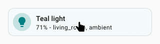

# Modèles

Tous les styles peuvent contenir des [modèles Jinja2](https://www.home-assistant.io/docs/configuration/templating/), qui seront traités par le moteur de Home Assistant.

UI eXtension met également les variables suivantes à disposition des modèles :

- `config` : la configuration complète de la carte, de l'entité ou du badge ; `config.entity` peut notamment être utile.
- `params` : les paramètres fournis par une boîte de dialogue ou une notification. Pour respecter la limite des messages WebSocket de Home Assistant lors des abonnements aux modèles, UIX limite ces paramètres à **512 KiB**. Si la limite est dépassée, les valeurs complètes du premier niveau sont retirées, de la plus grande à la plus petite. Les informations spécifiques plus petites, telles que `params.repository`, restent ainsi disponibles lorsqu'une grande valeur comme `params.marketplace` est omise.
- `user` : le nom de l'utilisateur connecté.
- `browser` : le `browser_id` du navigateur, si [browser_mod](https://github.com/thomasloven/hass-browser_mod) est installé.
- `hash` : la partie de l'URL située après `#`. UIX surveille `location-changed` et `popstate` pour réassocier les modèles lorsque `hash` change. L'option **Disable hash template variable and updates**, dans les réglages de performance de l'intégration, désactive ces mises à jour et rend `hash` indisponible.
- `panel` : des informations sur le panneau ou la vue affichée. Ce dictionnaire expose notamment les attributs suivants, avec des exemples de valeurs :
  - `panel.fullUrlPath`: "uix/another-test-view"
  - `panel.panelComponentName`: "lovelace"
  - `panel.panelIcon`: "mdi:card-bulleted-outline"
  - `panel.panelNarrow`: true
  - `panel.panelRequireAdmin`: false
  - `panel.panelTitle`: "UIX"
  - `panel.panelUrlPath`: "uix"
  - `panel.viewNarrow`: true
  - `panel.viewTitle`: "Test View"
  - `panel.viewUrlPath`: "another-test-view"
  - `panel.globalTheme`: "Red theme"
  - `panel.theme`: "Blue theme"

::: info Variables de thème du panneau
`panel.theme` est défini si la vue du tableau de bord possède directement un thème ; sinon, sa valeur est `None`. `panel.globalTheme` désigne le thème Home Assistant global actuellement appliqué. Le thème UIX effectif ne fait pas partie du dictionnaire `panel`.

:::
Vous pouvez déboguer les modèles UIX Jinja2 en plaçant le commentaire <code v-pre>{# uix.debug #}</code> n'importe où dans votre modèle. Vous verrez les messages de débogage lors de la liaison du modèle, de la mise à jour de valeur, de la réutilisation, de la déliaison et du désabonnement final. Chaque modèle reste abonné dans le cache pendant 20 secondes afin de faciliter l'application des modèles et d'améliorer légèrement la vitesse lorsque vous passez d'une vue à l'autre ou utilisez le même modèle sur des cartes de vues différentes.

## Macros

UI eXtension prend en charge les [macros Jinja2 réutilisables](https://jinja.palletsprojects.com/en/stable/templates/#macros), définies au niveau d'une carte ou d'un thème, qui sont ajoutées au début de chaque modèle de la carte.

### Définir des macros sur une carte

Les macros sont définies sous `uix.macros` dans la configuration de la carte. Une macro sans `returns` produit son modèle directement sous forme de chaîne. Utilisez-la pour insérer une valeur textuelle (par exemple une couleur CSS ou un nom d'icône) dans le modèle :

```yaml
type: tile
entity: light.living_room
uix:
  macros:
    state_color:
      params:
        - entity_id
        - name: color_on
          default: "'yellow'"
        - name: color_off
          default: "'gray'"
      template: "{{ color_on if is_state(entity_id, 'on') else color_off }}"
  style: |
    ha-card {
      background: {{ state_color(config.entity) }};
    }
```

Chaque entrée de macro accepte les clés suivantes :

| Clé | Obligatoire | Description |
| --- | -------- | ----------- |
| `template` | Oui | Le corps du modèle Jinja2 de la macro. |
| `params` | Non | La liste des paramètres acceptés. Chaque entrée est une chaîne (nom du paramètre) ou un dictionnaire contenant les clés `name` et `default` (voir ci-dessous). |
| `returns` | Non | La valeur `true` permet d’appeler la macro comme une fonction avec le filtre `as_function` de Home Assistant. Utilisez alors <code v-pre></code> dans le modèle pour renvoyer une valeur typée (booléen, nombre, etc.). |

Chaque élément de `params` peut être :

- Une **chaîne simple** : uniquement le nom du paramètre, par exemple `- entity_id`.
- Un **dictionnaire** avec `name` et `default` : le nom du paramètre et son expression Jinja2 par défaut :

```yaml
params:
  - entity_id
  - name: color_on
    default: "'yellow'"
  - name: color_off
    default: "'gray'"
```

Cela génère la signature de macro Jinja2 suivante :

```jinja

{{ color_on if is_state(entity_id, 'on') else color_off }}

```

La valeur `default` est insérée telle quelle comme expression Jinja2. Encadrez les valeurs textuelles d'apostrophes à l'intérieur de la chaîne YAML (par exemple `"'yellow'"`).

### Macros avec `returns`

Lorsqu'une macro produit son résultat directement (sans `returns`), celui-ci est toujours une chaîne : même <code>&#123;&#123; is_state(entity_id, "on") &#125;&#125;</code> renvoie la chaîne `"True"` ou `"False"`, et toute chaîne non vide est considérée comme vraie par Jinja2. Pour renvoyer une valeur booléenne ou numérique qui fonctionne correctement dans les conditions et les comparaisons, utilisez `returns: true`.

Avec `returns: true`, la macro suit la convention [`as_function`](https://www.home-assistant.io/docs/configuration/templating/#as_function) de Home Assistant : son nom interne devient `macro_<name>`, avec `returns` comme dernier paramètre, puis elle est exposée sous le nom `<name>` au moyen du filtre `as_function`. L'appelable `returns` est injecté automatiquement lorsque la macro est appelée comme une fonction :

```yaml
type: tile
entity: light.living_room
uix:
  macros:
    is_on:
      params:
        - entity_id
      returns: true
      template: ""
  style: |
    ha-card {
      --tile-color: {{ 'yellow' if is_on(config.entity) else 'gray' }} !important;
    }
```

Cela génère le bloc Jinja2 suivant, ajouté au début de chaque modèle :

```jinja




```

### Composer des macros

Les macros peuvent appeler d'autres macros définies dans la même carte. UIX détecte automatiquement ces dépendances et inclut toutes les macros nécessaires dans le résultat, même si seul l'appel à la macro externe apparaît dans le modèle principal.

```yaml
type: tile
entity: light.living_room
uix:
  macros:
    color_for_state:
      params:
        - entity_id
      template: "{{ 'green' if is_state(entity_id, 'on') else 'red' }}"
    border_style:
      params:
        - entity_id
      template: "2px solid {{ color_for_state(entity_id) }}"
  style: |
    ha-card {
      border: {{ border_style(config.entity) }};
    }
```

Même si le modèle de style utilise uniquement `border_style`, UIX inclut aussi `color_for_state`, car la première macro y fait référence. Le bloc Jinja2 suivant est ajouté au début de chaque modèle :

```jinja

{{ 'green' if is_state(entity_id, 'on') else 'red' }}


2px solid {{ color_for_state(entity_id) }}

```

### Importer des macros depuis des fichiers de modèles personnalisés

En plus de définir les macros directement, vous pouvez importer des macros depuis les [modèles réutilisables de Home Assistant](https://www.home-assistant.io/docs/configuration/templating/#reusing-templates) enregistrés dans `/config/custom_templates/*.jinja`. Pour cela, indiquez le nom du fichier (une simple chaîne) comme valeur de l'entrée de macro, au lieu d'un objet de définition :

```yaml
type: tile
entity: light.living_room
uix:
  macros:
    state_color: "my_macros.jinja"
  style: |
    ha-card {
      background: {{ state_color(config.entity) }};
    }
```

Cela génère l'instruction d'importation suivante, ajoutée au début de chaque modèle :

```jinja

```

La macro `state_color` doit être définie dans `/config/custom_templates/my_macros.jinja`. Chaque entrée de `macros` importe la macro portant son nom ; vous pouvez donc importer plusieurs macros depuis un même fichier ou depuis différents fichiers :

```yaml
uix:
  macros:
    state_color: "my_macros.jinja"
    is_on: "my_macros.jinja"
    format_date: "utils.jinja"
```

::: tip Utiliser des macros provenant de fichiers
Tous les fichiers de modèles doivent porter l'extension `.jinja` et faire moins de 5 Mio. Les modèles du dossier `/config/custom_templates` sont chargés au démarrage de Home Assistant. Pour les recharger sans redémarrer Home Assistant, exécutez l'action `homeassistant.reload_custom_templates`.

:::
Une même carte peut combiner librement des macros définies directement et des macros importées depuis des fichiers.

### Macros de thème

Vous pouvez également définir des macros dans un thème afin qu'elles soient disponibles pour toutes les cartes qui l'utilisent. Consultez [Thèmes - Macros](themes.md#macros) pour en savoir plus.

Les macros définies sur une carte sont prioritaires sur celles du thème portant le même nom ; une carte peut ainsi remplacer une macro du thème.

## Billets

Les billets sont des valeurs YAML nommées qui deviennent des constantes simples dans les modèles — utilisables **sans parenthèses**, contrairement aux macros. Ils sont disponibles dans les modèles UIX Styling et UIX Forge. Les valeurs textuelles peuvent référencer d'autres billets avec la syntaxe `{name}` ; l'ordre des déclarations n'a pas d'importance.

### Billets dans UIX Styling

Définissez les billets sous `uix.billets` dans une carte. Chaque billet est inséré sous la forme d'une instruction <code v-pre></code> avant chaque modèle de style de cette carte :

#### Interpolation des billets

Les billets textuels peuvent faire référence à d’autres billets avec la syntaxe `{name}`. Cette substitution est effectuée avant leur conversion en variables Jinja2. Utilisez `{name[N]}` pour désigner l’élément `N` d’un billet de type liste ; les indices commencent à zéro :

```yaml
uix:
  billets:
    room: "bed"                         # plain string
    entity_id: "light.{room}_light"     # → "light.bed_light"
    scenes:
      - bright
      - dim
    default_scene: "{scenes[0]}"        # → "bright"
  style: |
    ha-card { content: "{{ entity_id }} / {{ default_scene }}"; }
```

Les références sont résolues selon leurs dépendances ; l’ordre des déclarations n’a donc pas d’importance :

```yaml
billets:
  entity: "light.{room}_light" # → "light.bedroom_light"  (resolved after room)
  room: "{base}room"           # → "bedroom"  (resolved after base)
  base: "bed"
```

::: note Références circulaires
Si des billets se référencent en boucle, directement ou par une chaîne de références, aucun billet de cette boucle ne peut être résolu. UIX consigne une erreur pour chacun et conserve leurs valeurs telles quelles.

:::
```yaml
type: custom:uix-forge
entity: light.bed_light
forge:
  mold: card
  grid_options:
    columns: 7
  billets:
    my_color: teal
    max_brightness: 255
    tags:
      - living_room
      - ambient
element:
  type: tile
  entity: "{{ config.entity }}"
  name: "{{ my_color | capitalize }} light"
  tap_action:
    action: perform-action
    perform_action: light.turn_on
    target:
      entity_id: "{{ config.entity }}"
    data:
      brightness: "{{ max_brightness }}"
  uix:
    style: |
      ha-card {
        --tile-color: {{ my_color }} !important;
      }
      ha-tile-info span:nth-of-type(2):after {
      
        content: ' - {{ tags | join(', ') }} - MAX';
        font-weight: 900;
      
        content: ' - {{ tags | join(', ') }}';
      
      }
```



Dans les modèles, les billets s’utilisent comme des constantes simples :

```jinja
{{ accent_color }}         {# teal #}
{{ max_level + 1 }}        {# 101 #}
{{ tags | join(', ') }}    {# living_room, ambient #}
```

### Billets dans UIX Forge

Avec [UIX Forge](../forge/index.md), les billets définis sous `forge.billets` sont disponibles dans tous les modèles Forge **ainsi que** dans tout style `uix:` de la carte Forge ou de l'élément généré. Ils sont fusionnés avec les billets définis directement dans la configuration `uix:` ; ceux-ci restent prioritaires.

Consultez la référence complète [UIX Forge — Billets](../forge/forge.md#billets), qui décrit les types pris en charge et le comportement de remplacement des fonderies.
